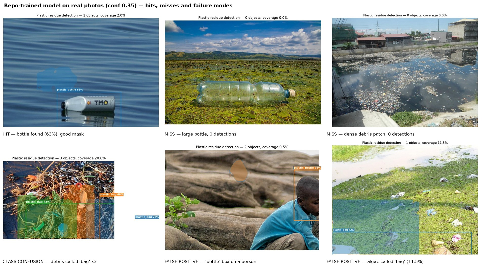

# First real-photo evaluation: findings vs previous results

**Repo:** `cemgurbey/plastic-water-segmentation` · **Date:** 2026-11-16
**Test set:** 40 copyright-free photos in `test_images/` (10 Openverse, 30 Wikimedia
Commons; CC0 / CC BY / CC BY-SA / public domain — attribution in
`test_images/SOURCES.csv`)
**Models:** repo-trained `yolo11n-seg` vs COCO-pretrained `yolo11n-seg` baseline,
both at confidence 0.35. Full method and per-image tables:
[`results/README.md`](README.md), [`repo_model/summary.csv`](repo_model/summary.csv),
[`coco_baseline/summary.csv`](coco_baseline/summary.csv).

## TL;DR

| | Previous results | What we found |
|---|---|---|
| Real-photo evaluation | None existed — no test images, no trained weights, no results | 40 photos evaluated, results in `results/` |
| Repo model, overall | Synthetic val mask mAP50 **0.799** (15 images) | Detections in **18/40** photos; mean contamination **2.58%** |
| Repo model, bottles | Synthetic val mask mAP50 **0.986** | **2 of 14** bottle-tagged photos got a bottle detection |
| Repo model, bags | Synthetic val mask mAP50 **0.486** (weakest class) | Catch-all: **20 of 26** detections were "bag" |
| Repo model, debris | Synthetic val mask mAP50 **0.926** | **2** debris detections in 24 debris-tagged photos |
| COCO baseline | Expected: "finds bottles, misses bags/debris" | **0/40** bottles — even at conf 0.10, only 1 in 40 |
| Colab notebook | Would not run (import errors) | Runs, after three fixes (see §5) |

The headline is the gap between synthetic validation and real photos: a model that
looked strong on synthetic data (mask mAP50 0.799, bottles 0.986) is weak on real
water, and the COCO baseline that was expected to at least find bottles found none.

## 1. What existed before (previous results)

Before this work the project had **no real-photo results at all**:

- **No test images.** `test_images/` was in `.gitignore`; nothing in the repo
  measured performance on real water.
- **No trained weights.** `*.pt` is gitignored and no checkpoint was shipped,
  so "the model" could not be run without training first.
- **The only numbers were synthetic-validation metrics** from training on
  procedurally generated data — 15 validation images, 47 instances:

| Class | Box mAP50 | Mask mAP50 |
|---|---|---|
| plastic_bottle | 0.986 | 0.986 |
| plastic_bag | 0.668 | 0.486 |
| plastic_debris | 0.943 | 0.926 |
| **All classes** | **0.866** | **0.799** |

- **The README's expectations** (written before any evaluation) said a model
  trained on the small procedural demo set "will miss a lot on real photos",
  and that the COCO baseline "finds bottles but not bags/debris". The first
  half was right; the second half turned out to be wrong — the baseline found
  no bottles at all (§4).

## 2. What we did

- **Test set.** 40 photos of plastic in/on water, curated from Openverse and
  Wikimedia Commons with clear CC0/CC BY/CC BY-SA/public-domain licensing,
  resized to max 1280 px. Rough visual tags (not ground truth): 24 debris,
  14 bottle, 2 bag. Nothing in the set was used for training.
- **Local run (CPU, smoke-test scale).** Procedural synthetic data only —
  60 train / 15 val images, `ProceduralPainter`, SAM refinement off —
  trained `yolo11n-seg` for 10 epochs (imgsz 640, batch 8). The notebook's
  production recipe is `yolo11m-seg`, 50 epochs, on a Colab GPU with
  diffusion data, so these numbers are a floor, not a ceiling.
- **Evaluation.** Both models ran on all 40 photos at conf 0.35, with
  per-image visualizations and `summary.csv` files. The COCO baseline was
  additionally re-run at conf 0.25 and 0.10 to check the zero result was
  real and not a threshold artifact.

## 3. What we found — the repo-trained model

| Metric | Value |
|---|---|
| Images with ≥ 1 detection | **18 / 40** |
| Images with zero detections | 22 / 40 |
| Mean contamination index | **2.58%** |
| Total objects detected | 26 (4 bottle, 20 bag, 2 debris) |
| Bottle-tagged photos with a bottle detection | **2 / 14** (images 01, 32) |
| Bottle-tagged photos with no detection at all | 9 / 14 |
| Dense Marilao River patches detected (13–16) | **0 / 4** |

Failure modes, in order of importance:

1. **Class confusion — "bag" became the catch-all.** 20 of the 26 detections
   were `plastic_bag`, including debris nests, reeds and algae. The bag class
   was already the weakest on synthetic validation (mask mAP50 0.486), and on
   real photos it absorbs everything the model cannot classify.
2. **Transparent bottles are missed.** Only 2 of 14 bottle-tagged photos got a
   bottle detection. The large, clearly visible Danube bottle in image 12 got
   nothing. Procedural training draws opaque rounded rectangles; real bottles
   are transparent, horizontal and half-submerged, with refraction and
   reflections the training data never showed.
3. **Dense scenes are invisible.** All four dense Marilao River patches
   (13–16) returned zero detections. Training caps at 4 objects per image
   with no overlap allowed, so dense multi-object scenes are out of
   distribution.
4. **False positives on texture and people.** Half a frame of algae was called
   a bag (image 03, 11.5% "coverage"), and a "bottle" box landed on a
   person's head (image 32, 38% confidence).
5. **What worked:** the clean, isolated bottle in image 01 — detected at 63%
   with a good mask. The pipeline works when the object looks like the
   training data; it fails when it doesn't.

## 4. What we found — the COCO baseline vs expectation

- **Expectation:** a COCO-pretrained detector should find bottles (a COCO
  class) while missing bags and debris (not COCO classes).
- **Reality: 0/40 bottles at conf 0.35.**
- **Verified, not assumed.** The model loads and detects other things fine:
  at conf 0.10 it calls the bottle in image 33 an "airplane" (0.26) and a
  "boat" (0.24). Re-running all 40 photos at conf 0.25 still found 0
  bottles; at conf 0.10 it found exactly 1 (image 32). The zero is real.
- **Interpretation:** transparent, horizontal, half-submerged bottles on
  water are effectively out-of-distribution for COCO's `bottle` class
  (upright, opaque bottles on tables). This is the strongest argument the
  project has for needing its own training data — even a general-purpose
  detector cannot see this object class in this setting.

## 5. What changed in the repo tonight (so the comparison is reproducible)

| Commit | Change |
|---|---|
| `bd88d19` | 40 copyright-free test images + notebook §8 (evaluate on real photos) |
| `325ccc9` | Colab fixes: regular `pip install .` instead of editable `-e` (editable installs need a kernel restart before the import works); weights path taken from `model.trainer.save_dir` instead of a hardcoded `logs/...` path (Ultralytics nests runs under `runs/<task>/<project>/<name>/`) |
| `309c917` | First results: `results/repo_model/`, `results/coco_baseline/`, `results/README.md` |
| `8c89592` | `.gitignore` fix: the unanchored `data/` pattern also matched `src/plastic_water_seg/data/`, and hatchling drops gitignored paths from the wheel — `pip install .` built a package without the data subpackage (`ModuleNotFoundError: No module named 'plastic_water_seg.data'`). Artifact dirs are now anchored to the repo root (`/data/` …) |
| `de476f3` | `USE_DIFFUSION` toggle in the notebook config cell (default off = procedural quickstart) |

## 6. Why the gap, and what to do next

The gap is a data-distribution gap, not a modeling bug: procedural shapes,
60 training images, procedural water backgrounds, no dense scenes, and a bag
class the model never learned to separate. The fixes, in priority order:

1. **Diffusion training path** (`USE_DIFFUSION = True` in the notebook) —
   photorealistic inpainted objects with real water interaction. Start with
   200 images, then 500+.
2. **Real backgrounds** in `data/backgrounds/` (rivers, canals, algae, reeds,
   glare) — not the 40 test images, which stay the eval set.
3. **Dense scenes** — raise `max_objects` to 6–8 so Marilao-style patches
   appear in training.
4. **More training** — 50 epochs, `yolo11m-seg`, `imgsz` 1024 for small
   objects; lower inference confidence toward 0.25 for recall.
5. **Prompt tuning** — the class prompts live in `config.py` (`CATEGORIES`);
   check the §5 samples first: if diffusion draws bags that look like
   debris, the labels teach the confusion.
6. **Judge on §8, not on synthetic val.** Synthetic mAP overstated real
   performance by a wide margin; the 40-photo summary is the metric that
   matters now. Re-running §8 after each training change is the loop.
